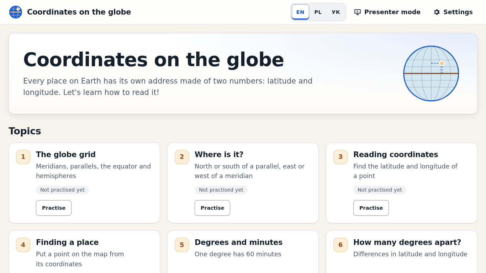
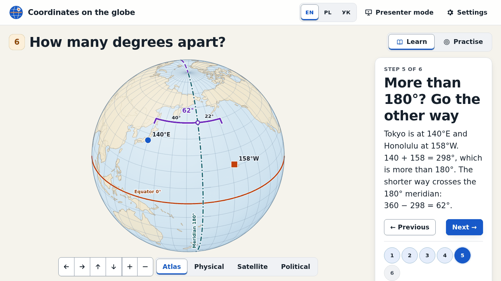
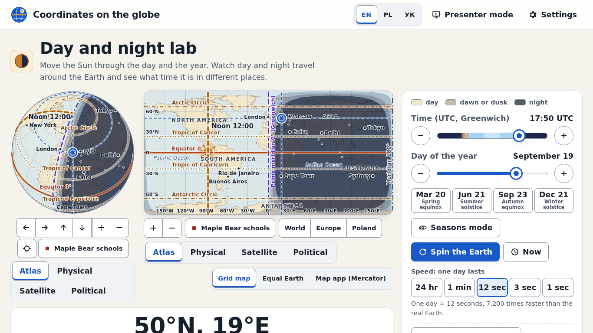
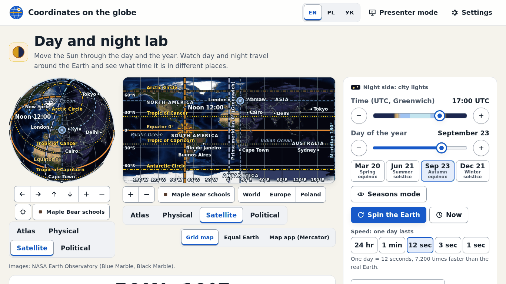
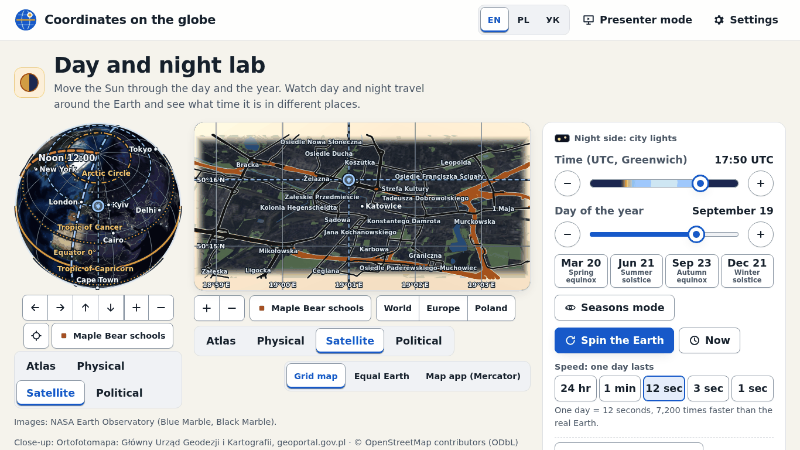

# Coordinates on the globe · Współrzędne · Координати

An interactive lesson about geographic coordinates for 6th graders, in English, Polish and Ukrainian.
One self-contained file — works offline, on phones, tablets, laptops and big classroom screens.

**Live demo (GitHub Pages):** <https://xsavikx.github.io/geo-coordinates/>

## Use it

Open `dist/geo-coordinates.html` in any modern browser (double-click works — no internet needed).

- **Learn**: 10 topics with step-by-step interactive explanations, from the basics of the
  grid to reading coordinates from a phone map app and why we have seasons.
- **Practise**: 10-question rounds with instant feedback (easy / medium / hard) for topics 1–8,
  with a hint button for unanswered questions and a celebration on a perfect round.
- **Test rehearsal**: 15 mixed questions with a review at the end.
- **Class quiz**: big-screen questions; the same quiz code gives the same questions.
- **Day and night lab**: day and night, the Sun's position and local solar time, set from the clock (or
  moved by hand through the day and the year), a Seasons mode (drag the Earth around its orbit; day length,
  sunrise and sunset, where the Sun is overhead and where polar day begins) and an advanced real-Sun switch
  (equation of time). A simplified mean-Sun model: the Sun stands over the meridian where
  local solar time is 12:00, so it can differ from the real Sun by up to about 4°.
- **Maps**: Grid, Equal Earth and Mercator (map-app style) flat projections, plus a globe with
  zoom; a detailed map of Poland and its neighbours with deep zoom (down to minutes of latitude and longitude).
- **Map styles**: Atlas (the lesson's own map), Physical (relief, sea depths, rivers and mountain names),
  Satellite (NASA Blue Marble, with Black Marble city lights on the night side) and Political (countries in
  colour with their names, in Poland's official border view). The style is remembered; a class quiz can use its
  own style for one run; worksheets and the cheat sheet are always Atlas. Drawn with WebGL, with a canvas
  fallback, and Atlas whenever a device cannot draw a style.
- **Places up close**: twelve 6 × 4 km boxes — the school in Katowice, Greenwich, Mitad del Mundo, the Arctic
  Circle at Rovaniemi, Warsaw, Kraków, Paris, Manhattan, Delhi, Sydney, Tokyo and Giza — where the map goes down
  to the streets: an aerial photo with roads, railways, water and parks drawn over it, and the street names. Six
  boxes use national open orthophotos at about 4–5 m a pixel, where individual buildings are visible; the other
  six use Copernicus Sentinel-2 at 10 m, where roads, parks and built-up areas read but single buildings do not.
  Reached from the "Places up close" list under the map, in free play, the lab and topic 9. A Settings switch
  turns the whole thing off.
- **Maple Bear schools layer**: an optional map layer showing Maple Bear school locations
  around the world, for a real-world "find the coordinates" exercise.
- **Presenter mode**: press `P` (fullscreen, larger text, higher contrast); `L` toggles a
  pointer highlight — built for teaching from the front of a classroom.
- **Cheat sheet**: a printable, one-page-per-language summary of every rule, with small
  diagrams — "Print / Save as PDF" from the page.
- **Worksheet**: pick topics, difficulty and question count, get a printable worksheet with a
  matching answer key; the same code always produces the same sheet.
- Progress badges on the home screen show your best score per topic.

Share a topic directly with a link such as `geo-coordinates.html#pl/topic-3/explore`.

This page is an independent educational resource and is **not affiliated with Maple Bear or
Google** — both names appear only as real-world examples (a school locator and a map app).

## Translations

`dist/translation-review.html` lists every text side by side for native-speaker review.
Texts live in `src/i18n/{en,pl,uk}.json`; a test enforces that all three languages define the
same set of keys.

## Develop

Requires Node 24 or newer.

    npm install
    npm run dev      # local dev server
    npm run check    # svelte-check (types)
    npm test         # unit tests (geography math, generators, i18n)
    npm run build    # dist/geo-coordinates.html + dist/translation-review.html
    npm run e2e      # Playwright + axe accessibility tests against the built file
    npm run shot -- en/lab lab   # full-page screenshots of one route: shots/lab-375x667.png, shots/lab-1366x768.png
    npm run shots:readme         # the README screenshots, docs/screenshots/{home,lesson,lab,satellite,close-up}.png (after a build)
    npm run brand                # icons and the social card in site-static/, from site-static/icon.svg
    npm run data:borders -- --download   # rebuild src/map/data/world-borders-pol.json (raw download cached in .cache/)
    npm run data:textures        # rebuild the map-style textures (needs Python 3 and Pillow with WebP; raw files cached in .cache/textures)
    npm run data:political       # rebuild src/map/data/political-pol.json
    npm run data:water           # rebuild src/map/data/physical-water.json
    npm run data:city-boxes      # rewrite src/map/data/city/boxes.json (the twelve 6 × 4 km boxes)
    npm run data:city-photos     # rebuild the twelve close-up photos (Python 3 + Pillow; network; cached in .cache/city)
    npm run data:city-streets    # rebuild the twelve street topologies from Overpass (network; cached in .cache/overpass)

`npm run shots:readme` captures the first 1366×768 screen of `en/`, `en/topic-6/explore/5`, `en/lab`, `en/lab`
again in the Satellite style at night, and the Katowice close-up in the lab, and reduces each PNG to 256 colours
when `python3` with Pillow is installed (otherwise it keeps full-colour PNGs and says so).

The built file must stay under 8 MiB; `npm run build` prints a per-asset breakdown with a line for each place.

## Author

Created by **Yurii Serhiichuk**.

- Website: <https://serhiichuk.dev>
- GitHub: <https://github.com/xSAVIKx>

Author details for the page footer live in `src/app/credits.ts`.

## License

- **Code** (everything under `src/`, `scripts/`, config files, and the compiled
  `dist/*.html`): [MIT](LICENSE), © 2026 Yurii Serhiichuk.
- **Lesson content** (texts, translations, cheat sheet and worksheet content):
  [CC BY 4.0](LICENSE-CONTENT.md).

## Credits

- Map data: [Natural Earth](https://www.naturalearthdata.com/) (public domain). Land and coastlines come via
  [world-atlas](https://github.com/topojson/world-atlas) (110m). World country borders follow Natural Earth's
  Poland point-of-view admin-0 countries (`ne_10m_admin_0_countries_pol`, version 5.1.1), which show Ukraine's
  internationally recognised borders, Crimea included; they are simplified by `npm run data:borders`
  (`scripts/build-world-borders.ts`). The Central Europe detail is Natural Earth 10m (`npm run data:regional`).
- Map rendering libraries: [world-atlas](https://github.com/topojson/world-atlas),
  [d3-geo](https://github.com/d3/d3-geo) and [topojson-client](https://github.com/topojson/topojson-client) (all ISC licensed).
- Interface framework: [Svelte](https://svelte.dev) (MIT licensed).
- Relief: Natural Earth `HYP_50M_SR_W` (public domain). Satellite images: NASA Earth Observatory — Blue Marble
  Next Generation (July 2004) and Black Marble 2016; NASA imagery is not subject to copyright in the United
  States. Political country shapes and physical rivers and lakes: Natural Earth
  (`ne_10m_admin_0_countries_pol`, `ne_50m_rivers_lake_centerlines`, `ne_50m_lakes`).
- Maple Bear school locations: collected from publicly published Maple Bear school websites;
  see [`LICENSE-CONTENT.md`](LICENSE-CONTENT.md) for the trademark and affiliation note.
- Close-up photos: Ortofotomapa — Główny Urząd Geodezji i Kartografii, geoportal.gov.pl (Katowice, Warsaw,
  Kraków); Orthophotos © IGN / Géoplateforme, Licence Ouverte Etalab 2.0 (Paris); 空中写真: 国土地理院シームレス空中写真（加工）
  / Geospatial Information Authority of Japan, seamlessphoto tiles, processed (Tokyo); USDA-FSA National Agriculture Imagery Program
  (NAIP) via USGS, public domain (Manhattan); Contains modified Copernicus Sentinel data 2024-2026 (Greenwich,
  Mitad del Mundo, Rovaniemi, Delhi, Sydney, Giza). Close-up streets, railways, water and parks: ©
  OpenStreetMap contributors, ODbL.
- Author: Yurii Serhiichuk — [serhiichuk.dev](https://serhiichuk.dev) ·
  [GitHub](https://github.com/xSAVIKx).

## Third-party licences

The built page bundles Svelte and clsx (MIT), d3-geo, d3-array, topojson-client and world-atlas (ISC), and map
data from Natural Earth (public domain). Their copyright and licence notices are written into
`dist/geo-coordinates.html` itself, as a comment right after `<!doctype html>`, by the build
(`scripts/licence-notices.ts`, which lists the packages whose code is actually in the bundle); `npm run build`
fails if they are missing. The same comment carries the NASA Earth Observatory note for the Blue Marble and
Black Marble satellite imagery, and the six close-up data notices (Copernicus Sentinel-2, OpenStreetMap, GUGiK,
IGN, GSI and USGS NAIP) described above under Credits and in
[`LICENSE-CONTENT.md`](LICENSE-CONTENT.md).

## Publishing

The built file is static. `dist/` is committed for offline use. GitHub Pages is served from a
GitHub Actions workflow (`.github/workflows/pages.yml`) that builds the project and runs `npm run site`
(`scripts/build-site.ts`). That script publishes `dist/geo-coordinates.html` as `index.html`, with two changes:
the app script moves to its own file, and the map textures, city photos and street data move into `data/`. The
page downloads each data file only when it needs it. The offline file in `dist/` keeps all of them inside. Next to the page go
`dist/translation-review.html` and the files in `site-static/`: the web app manifest and its icons, the social
card (`og-image.png`) and a sitemap.

The page head carries a search description, a canonical URL, Open Graph and Twitter card tags, theme colours and
LearningResource structured data. The favicon and the Apple touch icon are inlined as data URIs at build time
(`scripts/site-head.ts`), so they work offline too; the manifest link is added only when the page is opened at its
published address, so offline copies never ask for it. The search description follows the chosen language. See
[`docs/RELEASE.md`](docs/RELEASE.md) for the release checklist and the exact commands to
create the repository and enable Pages.
